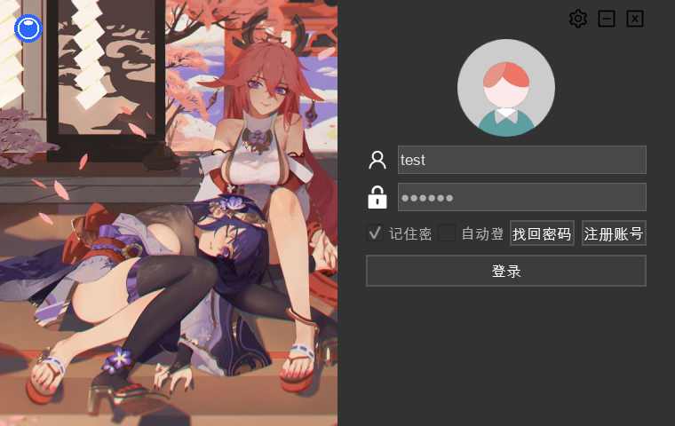
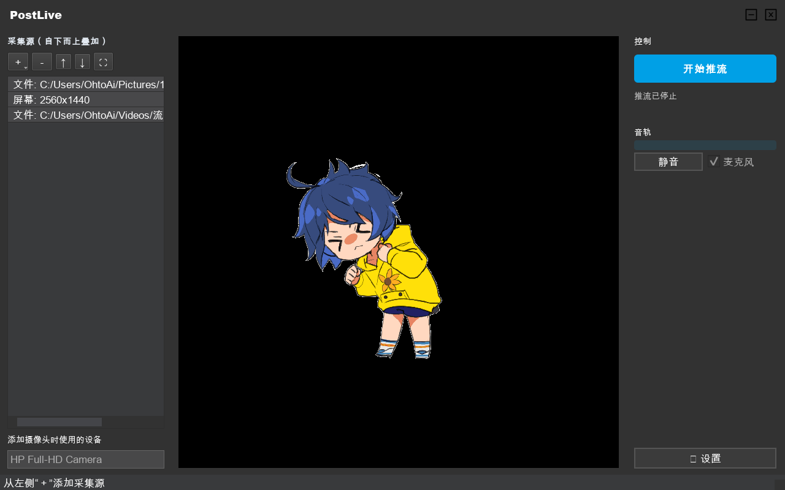

# PostLive

> 一个学习性质的直播平台桌面客户端：OBS 式场景编辑、多源采集（摄像头 / 屏幕 / 窗口 / 文件）、进程内 FFmpeg 编码，支持本地 HLS 浏览器观看与 RTMP 推流。
> 使用 C++17 / Qt 5.15 / FFmpeg 编写，Windows 10 / 11 x64。

[](https://github.com/ohto-ai/PostLive/actions/workflows/build.yml)
[](LICENSE)
[](docs/dependencies.md)
[](#环境要求)

> [!WARNING]
> 这是一个课程 / 学习项目，经过 2026 年的大规模重构（OBS 式直播页、进程内编码、Cloudflare 认证服务端），但仍未经过生产环境检验。代码与接口不要直接用于生产环境。

## 界面

| 登录 | 直播（OBS 式场景编辑器） |
| --- | --- |
|  |  |

## 功能状态

| 模块 | 状态 | 说明 |
| --- | --- | --- |
| 登录窗口 | ✅ | 深色扁平新 UI；账号 / 密码校验、头像、记住密码（token DPAPI 加密）、内嵌错误提示（无模态弹窗）、自动登录 |
| 场景编辑器 | ✅ | OBS 式源列表：添加 / 移除 / 排序，画布上拖拽移动、四角等比缩放、中心 / 边缘吸附参考线、右键菜单、方向键微调 |
| 采集源 | ✅ | 摄像头（DirectShow）、整个屏幕与按显示器选择（WGC / DXGI）、按标题捕获窗口（PrintWindow / WGC）、本地文件（拖入画布即可添加） |
| 进程内编码 | ✅ | 合成画布 BGRA→YUV420P→openh264，时间戳由应用生成；预览与推流同源（所见即所得），推流中可继续编辑场景 |
| 音频 | ✅ | 麦克风采集→重采样→AAC 音轨；实时电平表、运行时静音；设备缺失自动降级为纯视频 |
| 本地观看 | ✅ | HLS（2s 分片环形缓冲）写入数据目录，任意静态服务器 + hls.js 即可浏览器观看（延迟约 4–10 秒），模板见 [tools/nginx/](tools/nginx/) |
| RTMP 推流 | ✅ | 进程内 FLV over avio 直推，无子进程；推流服务器 / 分辨率 / 码率 / 帧率 / 编码器可配置 |
| 水印 | ✅ | 合成阶段叠加到画面左上角 |
| 系统托盘 | ✅ | 关闭 / 最小化到托盘、双击显示、退出前停止推流 |
| 设置窗口 | ✅ | 认证服务器、官网、水印、推流服务器、分辨率、码率、帧率、编码器、麦克风 |
| 日志 | ✅ | 分类日志（`postlive.*`）写入数据目录，采集 / 编码 / 认证全链路可追踪 |
| 数据目录 | ✅ | 配置 / 用户数据 / 分片 / 日志写入 `AppData/Roaming/ohto-ai/PostLive`，旧文件自动迁移；安装到 Program Files 也可用 |
| 单元测试 | ✅ | 核心逻辑 16 例（配置容错 / JSON / DPAPI token），CI 执行 |
| 认证服务端 | 🟡 | Cloudflare Workers 实现（D1 + KV，PBKDF2 加盐哈希）见 [worker/](worker/README.md)，待部署；本地 mock 可用于开发 |
| 遮罩窗口 | 🟡 | 已用父窗口事件过滤修复，建议实机复测最小化 / 还原 |
| 软件音轨采集 | ❌ | 采集应用 / 系统声音（WASAPI loopback）待实现 |
| Qt 6 | ❌ | 主要障碍（旧多媒体 API）已随进程内编码移除，剩余为常规迁移 |

完整清单见 [TODO.md](TODO.md)。

## 技术栈与依赖

| 依赖 | 版本 | 用途 | 获取方式 |
| --- | --- | --- | --- |
| Qt | 5.15.2 (MSVC 2019 64-bit) | Widgets / Network / Test | Qt 官方安装器 |
| FFmpeg | 7.x | 进程内解码 / 编码（libav）+ HLS / FLV 封装；SDK 已入库 | 头文件与导入库见 `third_party/ffmpeg/sdk/`，运行时 DLL 见 `third_party/ffmpeg/bin/`（本地目录被忽略） |
| cpp-httplib | 0.11.2 | mock 服务端 HTTP | 已内置于 `third_party/` |
| nlohmann/json | 3.11.2 | 配置、场景与用户数据 | 已内置于 `third_party/` |
| OpenSSL | 1.1.x（仅 HTTPS 认证时需要） | QtNetwork TLS | 外部部署，见 [docs/building.md](docs/building.md) |
| Node.js | 18+（仅认证服务端开发） | Cloudflare Worker 测试 | 官方安装器 |
| nginx | 1.x（本地观看，可选） | HLS 静态分发 | 外部部署，模板见 [tools/nginx/](tools/nginx/) |
| Windows SDK | 10（1903+） | WinRT（WGC）、DXGI、DbgHelp | Visual Studio 安装器 |

依赖的版本、许可证和更新方式见 [docs/dependencies.md](docs/dependencies.md) 与 [third_party/README.md](third_party/README.md)。

## 环境要求

- Windows 10 / 11 x64（版本 1903+ 可用 WGC 采集，更早版本自动回退 DXGI / PrintWindow）
- Visual Studio 2022（Desktop development with C++）
- CMake ≥ 3.21
- Qt 5.15.2，MSVC 2019 64-bit 套件

## 快速开始

```powershell
# 1. 告诉 CMake 去哪里找 Qt 5
$env:QT_ROOT = "C:/Qt/5.15.2/msvc2019_64"

# 2. 配置并构建（自动部署运行时与播放页）
cmake --preset windows-x64
cmake --build --preset release

# 3. 运行
.uild\windows-x64\Release\PostLive.exe
```

FFmpeg 的 SDK（头文件 / 导入库）已随仓库提交，构建无需额外安装；运行时 DLL（`avcodec-61.dll` 等）由 CMake 从 `third_party/ffmpeg/bin/` 复制到输出目录。

### 观看与推流

- **本地观看**：设置 → 勾选“本地 HLS 输出” → 添加采集源 → 开始推流 → 浏览器打开 `http://localhost:18080/player.html`（需要 nginx，配置模板见 [tools/nginx/](tools/nginx/)）；
- **推流到服务器**：设置 → 填写 `rtmp://` 服务器地址 → 开始推流（FLV 直推，`/livehime` 路径自动追加）。

### 认证服务端

登录 / 用户资料需要一个认证服务端。仓库提供两种：

- **Cloudflare Workers**（推荐，见 [worker/README.md](worker/README.md)）：D1 存储用户（PBKDF2 加盐哈希）、KV 管理 token 与限流，`workers.dev` 自带 HTTPS；
- **本地 mock**（开发联调，见 [tools/mock-server/README.md](tools/mock-server/README.md)）：默认地址 `http://localhost:8877/api`，示例账号 `test` / `123456`。

认证请求使用 QtNetwork，支持 `http://` / `https://`。Qt 5.15 在 Windows 上使用 OpenSSL 1.1.x：连接 HTTPS 服务时，需要把 `libssl-1_1-x64.dll` / `libcrypto-1_1-x64.dll` 放到 `PostLive.exe` 旁边，或通过 `POSTLIVE_OPENSSL_DIR` 让 CMake 复制。

## 项目结构

```text
PostLive/
├── assets/                  # 运行时资源（推流用 logo）
├── cmake/                   # CMake 辅助脚本（运行时部署）
├── config/                  # 首次运行使用的默认配置
├── design/                  # 原始 Sketch 设计稿
├── docs/                    # API、构建、架构、部署、调研文档
├── packaging/               # Inno Setup 安装脚本
├── src/
│   ├── app/                 # 登录 / 设置 / 直播窗口（场景编辑器）
│   ├── core/                # 配置、日志、HTTP、下载器、JSON 工具
│   ├── media/               # 采集源、解码线程、合成预览、编码器
│   │   └── capture/         # WGC / DXGI / PrintWindow 采集引擎
│   ├── widgets/             # 无边框窗口与通用控件
│   ├── resources/           # .qrc 与图片 / 图标
│   ├── platform/            # 窗口枚举等 Win32 辅助
│   └── main.cpp
├── tests/                   # 核心逻辑单元测试（Qt Test）
├── tools/
│   ├── mock-server/         # 本地 mock 认证服务端（开发用）
│   └── nginx/               # 本地观看的 nginx 配置与播放页
├── worker/                  # Cloudflare Workers 认证服务端
├── third_party/             # nlohmann/json、cpp-httplib、FFmpeg SDK / 运行时
├── CMakeLists.txt
├── CMakePresets.json
└── TODO.md
```

## 运行时文件

可写数据位于 `QStandardPaths::AppDataLocation`，即 `C:/Users/<用户>/AppData/Roaming/ohto-ai/PostLive/`：

| 文件 / 目录 | 说明 |
| --- | --- |
| `application.json` | 场景、自动登录、当前用户、认证服务器、官网、推流服务器、分辨率 / 码率 / 帧率 / 编码器 / 麦克风、水印。首次构建时从 `config/application.default.json` 创建，之后不会被覆盖 |
| `users.json` | 本地用户列表与 token（Windows DPAPI 加密）；token 失效后需重新登录 |
| `hls/livehime.m3u8` + `.ts` | 本地观看的 HLS 播放列表与分片（环形缓冲） |
| `log/PostLive.log` | 分类日志（采集 / 编码 / 认证 / 设备） |
| `user/avatar/*.avatar` | 登录后下载的头像缓存 |

可执行文件目录下保留只读资源（`assets/` 推流 logo、Qt / FFmpeg 运行时 DLL、`player.html` 播放页）。程序启动时会把工作目录切换到可执行文件所在目录。

## 文档

| 文档 | 内容 |
| --- | --- |
| [docs/building.md](docs/building.md) | 构建、CMake 选项、运行与排错 |
| [docs/architecture.md](docs/architecture.md) | 模块划分、登录 / 采集 / 编码 / 推流流程 |
| [docs/broadcast-ui-research.md](docs/broadcast-ui-research.md) | 直播页重做的产品调研与方案 |
| [docs/dependencies.md](docs/dependencies.md) | 依赖清单、版本与许可证 |
| [docs/api.md](docs/api.md) | 客户端期望的认证 API |
| [docs/database.md](docs/database.md) | 用户数据格式（开发示例） |
| [docs/streaming.md](docs/streaming.md) | 推流实现、设备名与水印 |
| [docs/rtmp-server.md](docs/rtmp-server.md) | Nginx + nginx-rtmp-module 部署 |
| [tools/nginx/](tools/nginx/) | 本地观看的 nginx 配置与播放页 |
| [worker/README.md](worker/README.md) | Cloudflare Workers 认证服务端部署 |
| [docs/cloudflare.md](docs/cloudflare.md) | Cloudflare 免费认证 / 推流方案评估 |
| [docs/directui-evaluation.md](docs/directui-evaluation.md) | 去除 Qt、改用 DirectUI 的可行性调研 |
| [docs/legacy.md](docs/legacy.md) | 已移除的旧子工程与找回方式 |
| [tools/mock-server/README.md](tools/mock-server/README.md) | 本地 mock 认证服务端 |
| [TODO.md](TODO.md) | 路线图 / 未完成事项 |
| [CHANGELOG.md](CHANGELOG.md) | 变更记录 |
| [CONTRIBUTING.md](CONTRIBUTING.md) | 贡献指南 |
| [SECURITY.md](SECURITY.md) | 安全问题报告与已知限制 |

## 历史与遗留工程

仓库早期的 Visual Studio 解决方案包含登录、推流、连接池、FFmpeg demo 等 9 个子工程，多数已无法独立构建。整理时只保留主客户端，其余工程从工作区移除，但仍可通过 git 历史找回：

- `v1.0.0.1`、`v1.0.0.2` 标签保留了原始工程；
- 详见 [docs/legacy.md](docs/legacy.md)。

## License

[GPL-3.0](LICENSE)。第三方组件的许可证见 [THIRD_PARTY_NOTICES.md](THIRD_PARTY_NOTICES.md)。
