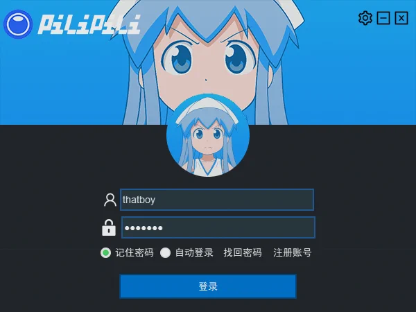

# PostLive

> 一个学习性质的直播平台桌面客户端：登录、用户资料、摄像头预览与 RTMP 推流。
> 使用 C++17 / Qt 5.15 / FFmpeg 编写，Windows 10 / 11 x64。
>
> A learning-focused live streaming desktop client built with C++17, Qt 5.15 and FFmpeg.

[](https://github.com/ohto-ai/PostLive/actions/workflows/build.yml)
[](LICENSE)
[](docs/dependencies.md)
[](#环境要求)

> [!WARNING]
> 这是一个 2020 年的课程 / 学习项目，目前只完成了工程化整理，功能并不完整。代码与接口都不要直接用于生产环境。

## 界面



## 功能状态

| 模块 | 状态 | 说明 |
| --- | --- | --- |
| 登录窗口 | ✅ | 账号 / 密码校验、头像展示、记住密码（保存 token）、连接超时 |
| 自动登录 | ✅ | `application.json` 中的 `auto_login`；token 失效会清理，编辑账号 / 密码或取消勾选可中止 |
| 用户资料 | ✅ | 登录后向 `/api` 请求头像与性别 |
| 摄像头 | ✅ | 枚举设备、本地预览、设备切换、热插拔刷新 |
| 麦克风 | ✅ | 枚举 DirectShow 音频设备，支持 `virtual-audio-capturer`、热插拔刷新 |
| 分辨率 | ✅ | 通过下拉框选择输出分辨率 |
| RTMP 推流 | ✅ | `QProcess` 调用 FFmpeg，可选 logo 水印；状态栏显示启动 / 停止 / 错误 |
| 系统托盘 | ✅ | 关闭 / 最小化到托盘、双击显示、退出前停止推流、托盘菜单可打开设置 |
| 设置窗口 | ✅ | 认证服务器、官网、水印开关，保存到 `application.json`；可从登录界面或托盘打开 |
| 码率 / 帧率 / 编码器 | ✅ | 主窗口可选择，默认 `Auto`，随 `application.json` 持久化 |
| 预览开关 | ✅ | 主窗口勾选 / 取消预览；推流时自动停止并禁用 |
| 遮罩窗口 | 🟡 | 已用父窗口事件过滤修复，建议实机复测最小化 / 还原 |
| 认证服务端 | ❌ | 客户端认证地址可配置，但仓库不包含可用服务端 |
| Qt 6 | ❌ | 当前使用 Qt 5 的 `QCamera` / `QAudioDeviceInfo` API |

完整清单见 [TODO.md](TODO.md)。

## 技术栈与依赖

| 依赖 | 版本 | 用途 | 获取方式 |
| --- | --- | --- | --- |
| Qt | 5.15.2 (MSVC 2019 64-bit) | Widgets / Network / Multimedia | Qt 官方安装器 |
| FFmpeg | 7.x（运行时） | 摄像头采集、编码、RTMP 推流 | 外部安装或 `third_party/ffmpeg`（已忽略，不入库） |
| cpp-httplib | 0.11.2 | 同步 HTTP 客户端 | 已内置于 `third_party/` |
| nlohmann/json | 3.11.2 | 配置与用户数据 | 已内置于 `third_party/` |
| Windows SDK | 10 | DbgHelp、Win32 API | Visual Studio 安装器 |
| Inno Setup | 6 | 安装包（可选） | 外部安装 |

依赖的版本、许可证和更新方式见 [docs/dependencies.md](docs/dependencies.md) 与 [third_party/README.md](third_party/README.md)。

## 环境要求

- Windows 10 / 11 x64
- Visual Studio 2022（Desktop development with C++）
- CMake ≥ 3.21
- Qt 5.15.2，MSVC 2019 64-bit 套件（与 VS 2022 的 MSVC 二进制兼容）
- FFmpeg（推流时需要；编译不强制）

## 快速开始

```powershell
# 1. 告诉 CMake 去哪里找 Qt 5
$env:QT_ROOT = "C:/Qt/5.15.2/msvc2019_64"

# 2. 配置并构建
cmake --preset windows-x64
cmake --build --preset release

# 3. 运行
.\build\windows-x64\Release\PostLive.exe
```

构建过程中会自动把 `assets/`、默认配置以及找到的 FFmpeg 复制到可执行文件旁边。
详细步骤、CMake 选项和常见问题见 [docs/building.md](docs/building.md)。

### FFmpeg

推流依赖外部的 `ffmpeg.exe`。可以：

- 把 FFmpeg 解压到 `third_party/ffmpeg/`（该目录已被 `.gitignore` 忽略）；或
- 配置时传入 `-DPOSTLIVE_FFMPEG_DIR=/path/to/ffmpeg`。

CMake 会把 `ffmpeg.exe` 与 `av*.dll` / `sw*.dll` 复制到输出目录。没有 FFmpeg 时程序仍可编译运行，只是点击“开播”会失败。CI 产出的 zip 也不包含 FFmpeg，需要自行放入。

### 认证服务端

客户端默认向 `http://localhost:8877/api` 发送登录 / 资料请求，可在设置窗口中修改认证服务器地址（写入 `application.json` 的 `auth_server`）。仓库包含一个开发用 mock 服务端，见 [tools/mock-server/README.md](tools/mock-server/README.md)；生产认证服务端仍不包含，协议见 [docs/api.md](docs/api.md)。当前构建只支持 `http://`；HTTPS 需要启用 OpenSSL 或改用 QtNetwork。

## 项目结构

```text
PostLive/
├── assets/                  # 运行时资源（推流用 logo）
├── cmake/                   # CMake 辅助脚本
├── config/                  # 首次运行使用的默认配置
├── design/                  # 原始 Sketch 设计稿
├── docs/                    # API、构建、架构、部署文档
├── packaging/               # Inno Setup 安装脚本
├── src/
│   ├── app/                 # 登录 / 设置 / 直播窗口
│   ├── core/                # 配置、HTTP、下载器、JSON 工具
│   ├── widgets/             # 无边框窗口与通用控件
│   ├── resources/           # .qrc 与图片 / 图标
│   ├── platform/            # Windows 版本资源模板
│   └── main.cpp
├── tools/mock-server/       # 本地 mock 认证服务端（开发用）
├── third_party/             # 内置头文件依赖；FFmpeg 本地目录被忽略
├── CMakeLists.txt
├── CMakePresets.json
├── CONTRIBUTING.md
├── LICENSE
├── README.md
└── TODO.md
```

## 运行时文件

| 文件 / 目录 | 说明 |
| --- | --- |
| `application.json` | 窗口几何、自动登录、当前用户、认证服务器、官网、编码器 / 码率 / 帧率 / 预览 / 水印设置。首次构建时从 `config/application.default.json` 创建，之后不会被覆盖 |
| `users.json` | 本地用户列表与 token。首次构建时从 `config/users.default.json` 创建 |
| `assets/pilipili-logo.png` | 推流时叠加到画面左上角的 logo |
| `user/avatar/*.avatar` | 登录后下载的头像缓存 |
| `ffmpeg.exe`、`av*.dll`、`sw*.dll` | 推流运行时，由 CMake 复制 |
| `PostLive.dmp` | 未处理异常时生成的 minidump |

程序启动时会把工作目录切换到可执行文件所在目录，因此从任意位置启动都能找到这些文件。

## 文档

| 文档 | 内容 |
| --- | --- |
| [docs/building.md](docs/building.md) | 构建、CMake 选项、运行与排错 |
| [docs/architecture.md](docs/architecture.md) | 模块划分、登录与推流流程 |
| [docs/dependencies.md](docs/dependencies.md) | 依赖清单、版本与许可证 |
| [docs/api.md](docs/api.md) | 客户端期望的认证 API |
| [docs/database.md](docs/database.md) | 用户数据格式（开发示例） |
| [docs/streaming.md](docs/streaming.md) | 推流实现、设备名与水印 |
| [docs/ffmpeg-commands.md](docs/ffmpeg-commands.md) | 常用 FFmpeg 命令 |
| [docs/rtmp-server.md](docs/rtmp-server.md) | Nginx + nginx-rtmp-module 部署 |
| [docs/cloudflare.md](docs/cloudflare.md) | Cloudflare 免费认证 / 推流方案评估 |
| [docs/directui-evaluation.md](docs/directui-evaluation.md) | 去除 Qt、改用 DirectUI 的可行性调研 |
| [docs/legacy.md](docs/legacy.md) | 已移除的旧子工程与找回方式 |
| [tools/mock-server/README.md](tools/mock-server/README.md) | 本地 mock 认证服务端 |
| [TODO.md](TODO.md) | 路线图 / 未完成事项 |
| [CHANGELOG.md](CHANGELOG.md) | 变更记录 |
| [CONTRIBUTING.md](CONTRIBUTING.md) | 贡献指南 |
| [SECURITY.md](SECURITY.md) | 安全问题报告与已知限制 |

## 历史与遗留工程

仓库早期的 Visual Studio 解决方案包含登录、推流、连接池、FFmpeg demo 等 9 个子工程，多数已无法独立构建。本次整理只保留主客户端，其余工程从工作区移除，但仍可通过 git 历史找回：

- `v1.0.0.1`、`v1.0.0.2` 标签保留了原始工程；
- 详见 [docs/legacy.md](docs/legacy.md)。

## License

[GPL-3.0](LICENSE)。第三方组件的许可证见 [THIRD_PARTY_NOTICES.md](THIRD_PARTY_NOTICES.md)。
