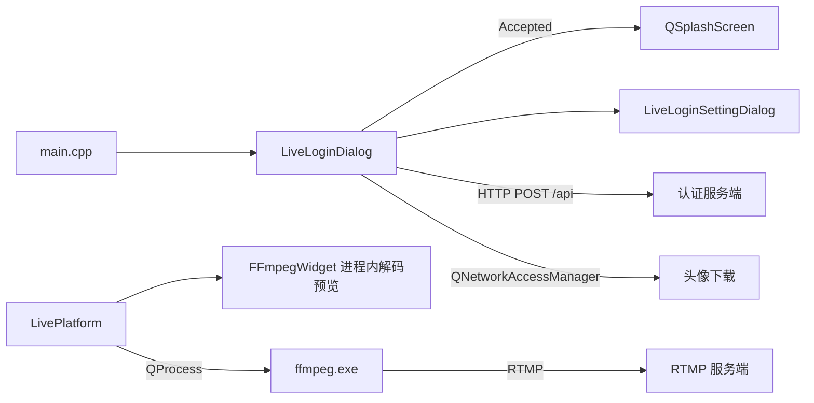
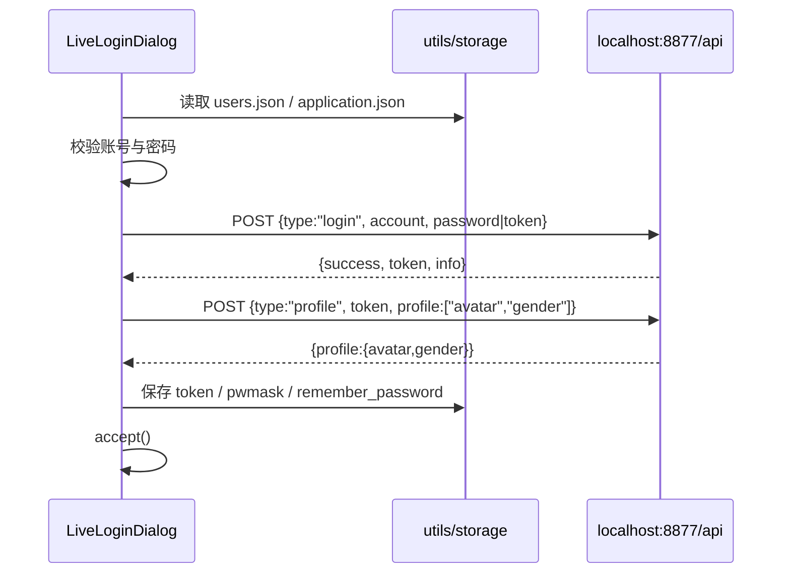
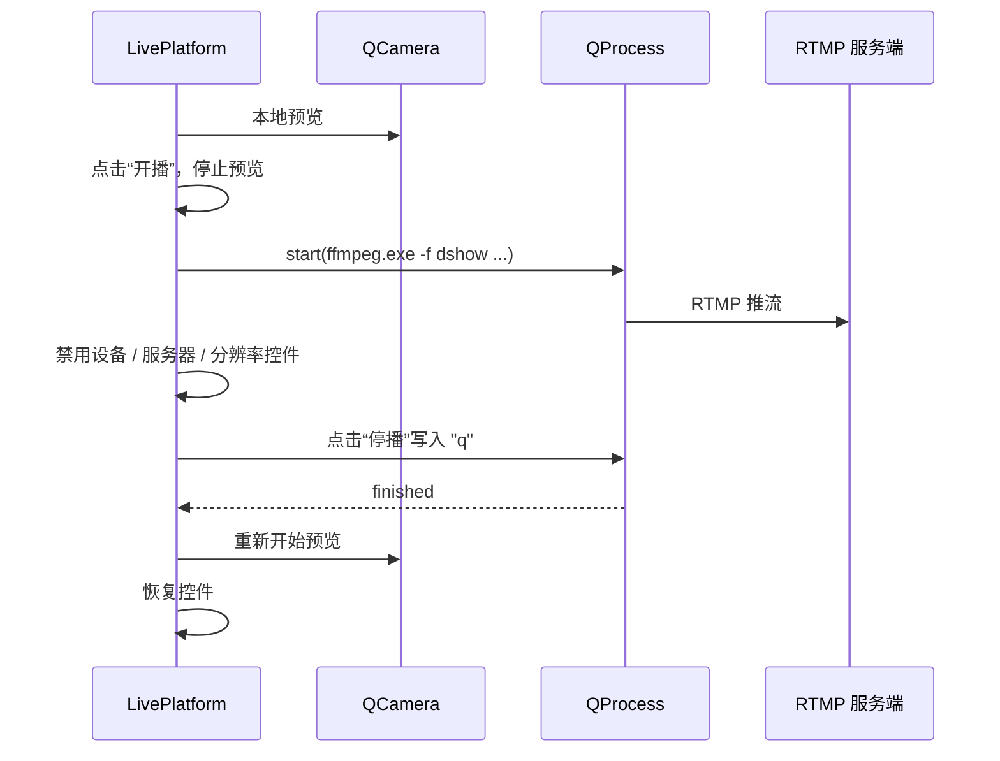

# 架构说明

## 总览

PostLive 是一个单进程 Qt Widgets 应用，推流通过子进程调用 FFmpeg 完成。



## 目录与模块

| 目录 | 职责 |
| --- | --- |
| `src/main.cpp` | 初始化 `QApplication`、工作目录、日志、配置与用户数据，控制登录 → 主窗口流程 |
| `src/app/` | 业务窗口：登录、设置、直播 |
| `src/core/` | 与界面无关的支撑代码：配置读写、HTTP 客户端、头像下载、窗口配置序列化、日志 |
| `src/media/` | 进程内 FFmpeg：输入设备抽象、解码线程、预览控件、推流参数构建 |
| `src/platform/` | Win32 平台辅助：可见顶层窗口枚举 |
| `src/widgets/` | 可复用的无边框窗口基类、拖拽、阴影、点击标签与密码输入框 |
| `src/resources/` | Qt 资源（`.qrc`）与图片 / 图标 |
| `src/platform/` | Windows 版本资源模板，由 CMake 注入版本号与图标路径 |
| `third_party/` | cpp-httplib（mock 服务端）、nlohmann/json 头文件；FFmpeg 本地目录被忽略 |

### 关键类

| 类 | 位置 | 说明 |
| --- | --- | --- |
| `LiveLoginDialog` | `src/app` | 登录、自动登录、头像、记住密码、打开设置 |
| `LiveLoginSettingDialog` | `src/app` | 认证服务器、官网、水印设置；可从登录界面或托盘打开 |
| `LivePlatform` | `src/app` | 摄像头预览、设备枚举、推流、托盘 |
| `AsyncDownloader` | `src/core` | 基于 `QNetworkAccessManager` 的异步下载 |
| `WidgetConfigInfo` | `src/core` | 窗口几何、透明度、遮罩属性的 JSON 序列化 |
| `log`（Logging） | `src/core` | `QLoggingCategory` 分类日志，写入 `log/PostLive.log` 并镜像 stderr |
| `utils` / `storage` | `src/core` | 配置与用户数据加载、保存，全局状态 |
| `BaseWidget` / `BaseDialog` / `BaseMainWindow` | `src/widgets` | 统一窗口事件与信号 |
| `DragableWidget` / `DragableDialog` / `DragableMainWindow` | `src/widgets` | 无边框窗口拖动 |
| `ShadowWidget` | `src/widgets` | 窗口阴影与设置对话框遮罩 |
| `PasswordEdit` | `src/widgets` | 密码编辑、假密码回填、MD5 |
| `ImageLabel` | `src/widgets` | object-fit（cover/fit）图片绘制，登录页左图 |
| `FileDropZone` | `src/widgets` | 文件拖放接收（FFmpegWidget 基类，拖入即切源） |
| `FFmpegInputDevice` | `src/media` | 采集源统一抽象：dshow 摄像头/麦克风、gdigrab 桌面/窗口、本地文件 |
| `FFmpegVideo` | `src/media` | 解码线程，`frameReady(QImage)` 供预览 |
| `StreamSource` | `src/media` | 场景源模型（kind/name/title，JSON 持久化） |
| `ScenePreview` | `src/media` | 合成预览：每源一个解码线程，画布内按 z 序叠加绘制 |
| `buildSceneArgs` | `src/media/StreamArgs` | 纯函数：按场景（有序源列表）构建 ffmpeg.exe 多输入 + filter_complex 推流参数（有单测） |

## 启动流程

1. `main.cpp` 创建 `QApplication`，设置应用名 / 版本。
2. `QDir::setCurrent(QCoreApplication::applicationDirPath())`，让所有相对路径以可执行文件目录为基准。
3. `log::initLogging()` 安装消息处理器，日志写入 `log/PostLive.log`（2 MB 轮转，保留 1 份备份）。
4. `utils::loadConfig()` 读取 `application.json`。
5. `utils::loadUserData()` 读取 `users.json`，异步下载缺失头像。
6. 显示 `LiveLoginDialog`；登录成功后先显示 splash 动画，再创建 `LivePlatform`。
7. 关闭主窗口时保存配置与用户数据；未处理异常生成 `PostLive.dmp` 并记录日志。

## 错误反馈与日志

应用不使用 `QMessageBox` 等模态弹窗：登录失败显示在登录框底部的内嵌提示（约 8 秒后自动清除），设置校验失败在字段上标红并内嵌说明，推流错误显示在主窗口状态栏，全局 / 崩溃路径只记录日志。

日志使用 `QLoggingCategory` 分类：`postlive.app`（生命周期）、`postlive.core`（配置与存储）、`postlive.network`（认证请求）、`postlive.stream`（推流）、`postlive.device`（设备枚举）。每条日志形如 `2026-10-29 23:27:22.462 [info] postlive.app: ...`，文件超过 2 MB 时在启动或写入时轮转为 `PostLive.log.1`。核心逻辑的单元测试在 `tests/`，用 `ctest --preset windows-x64` 运行。

## 登录流程



- 密码只保存 MD5，且“记住密码”实际上是保存 token 并用假密码回填输入框。
- `application.json` 的 `login.auto_login` 为 `true` 时，登录窗口显示 100 ms 后自动调用登录；取消勾选或编辑账号 / 密码会停止本次自动登录。
- 认证地址从 `application.json` 的 `auth_server` 读取（默认 `http://localhost:8877`），QtNetwork 异步请求，5 s transfer timeout；HTTPS 需要 OpenSSL 1.1.x DLL。
- token 登录失败时会清除 `remember_password` 与自动登录，避免下次启动重复失败。

## 采集与预览

预览与推流是两条独立链路，同一时刻只开一条（推流前强制停预览，避免 dshow 设备被双开占用）：

- **场景**：主界面维护一个有序源列表（`StreamSource`，持久化于 `scene.sources`）；首层为主画面，其余自下而上叠加；每个源带画布矩形，可在预览画布上拖拽/缩放（OBS 式）。
- **采集引擎**：摄像头/文件走 libav（`FFmpegVideo`）；**窗口走 PrintWindow + PW_RENDERFULLCONTENT**（修复加速窗口黑屏）；**屏幕走 DXGI 桌面复制**（多屏逐显示器、模式切换自动重初始化、手动绘制光标），见 `src/media/capture/`。
- **预览与推流同源（OBS 式 WYSIWYG）**：`ScenePreview` 把整个场景合成为固定尺寸画布（=推流分辨率，16:9），画布通过 `canvasReady` 以 rawvideo/bgra 经 stdin 喂给 `ffmpeg.exe`（背压丢帧保护）；推流时预览继续运行，场景修改即时生效，dshow 设备不再双开。水印在合成阶段绘制。
- **音频**：麦克风为全局推流音轨（设置选设备、控制 dock 开关）；文件源音频暂未接入。
- 窗口选择器枚举可见顶层窗口（`src/platform/WindowList`，过滤最小化 / 工具窗口 / cloaked UWP）；gdigrab 只认窗口标题，同标题窗口无法区分。

UI 使用全局主题 `src/resources/postlive.qss`（源自 PostLive.Re 的设计）：深炭色 + 蓝色 accent，`main.cpp` 启动时整体应用；登录窗口为 760x480 左图右表单布局（`ImageLabel` 做 cover 裁剪）。

## 推流流程



FFmpeg 命令由 `LivePlatform.cpp` 拼接，当前参数：

```text
ffmpeg.exe -hide_banner -loglevel warning -nostats
  -f dshow -i video="<camera>"
  -i assets/pilipili-logo.png
  -f dshow -i audio="<microphone>"
  -filter_complex "overlay=5:5"
  -f flv [-c:v <encoder>] [-b:v <kbps>k] [-r <fps>]
  -pix_fmt yuv420p -s <WxH> <server>/livehime
```

编码器 / 码率 / 帧率为 `Auto` 时不追加对应参数；本地预览由主窗口“预览”复选框控制，推流期间自动停止。具体说明见 [streaming.md](streaming.md)。

## 运行时文件

| 文件 | 读取方 | 说明 |
| --- | --- | --- |
| `application.json` | `utils::loadConfig` | 窗口位置、自动登录、当前用户、认证服务器、官网、编码器 / 码率 / 帧率 / 预览 / 水印设置 |
| `users.json` | `utils::loadUserData` | 用户列表、token、pwmask、头像路径 |
| `assets/pilipili-logo.png` | `LivePlatform` | 推流水印 |
| `user/avatar/*.avatar` | `AsyncDownloader` | 头像缓存 |
| `ffmpeg.exe` / `av*.dll` / `sw*.dll` | `QProcess` | 推流运行时 |

## 线程与进程模型

- UI、网络、配置读写都在主线程；`AsyncDownloader` 使用 Qt 事件循环，不阻塞登录窗口。
- FFmpeg 是独立进程，通过 `QProcess` 启动；客户端的摄像头预览在推流期间停止，避免设备占用冲突。
- 停播先向 FFmpeg 写入 `q`，3 秒后 `terminate()`，再 2 秒后 `kill()`；状态与错误通过状态栏呈现，详情写入 `log/PostLive.log`。
- 没有显式的线程池或后台任务队列。

## 已知限制

- RTMP 路径（`/livehime`）仍硬编码；认证支持 `http(s)://`，Qt 5.15 的 HTTPS 需要 OpenSSL 1.1.x DLL。
- 设置窗口目前覆盖认证服务器、官网、水印；码率 / 编码器等仍在主窗口。
- 密码 / token 使用 MD5 与明文 JSON 存储，不适合生产。
- 仅支持 Qt 5.15 与 Windows。完整清单见 [TODO.md](../TODO.md)。
