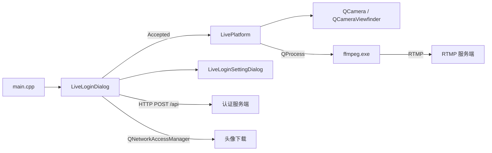
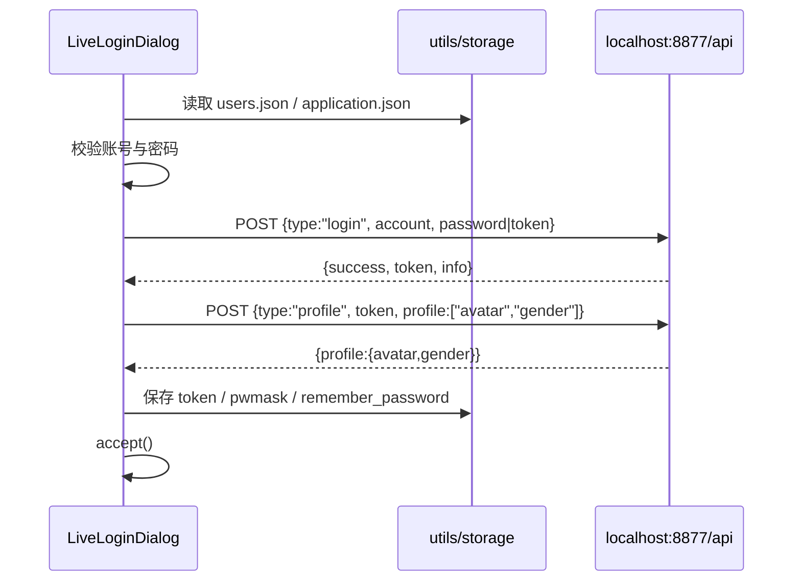
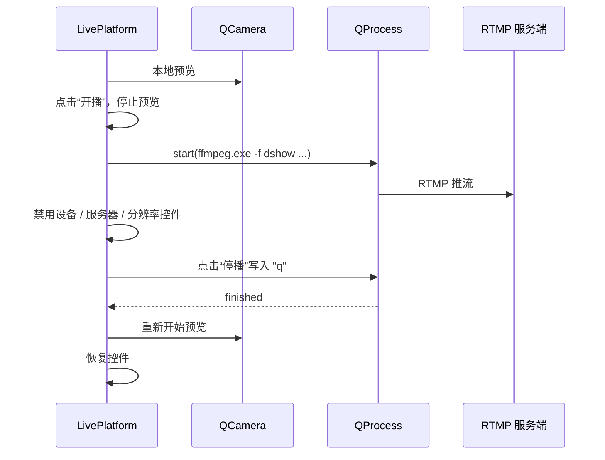

# 架构说明

## 总览

PostLive 是一个单进程 Qt Widgets 应用，推流通过子进程调用 FFmpeg 完成。



## 目录与模块

| 目录 | 职责 |
| --- | --- |
| `src/main.cpp` | 初始化 `QApplication`、工作目录、配置与用户数据，控制登录 → 主窗口流程 |
| `src/app/` | 业务窗口：登录、设置、直播 |
| `src/core/` | 与界面无关的支撑代码：配置读写、HTTP 客户端、头像下载、窗口配置序列化 |
| `src/widgets/` | 可复用的无边框窗口基类、拖拽、阴影、点击标签与密码输入框 |
| `src/resources/` | Qt 资源（`.qrc`）与图片 / 图标 |
| `src/platform/` | Windows 版本资源模板，由 CMake 注入版本号与图标路径 |
| `third_party/` | cpp-httplib、nlohmann/json 头文件；FFmpeg 本地目录被忽略 |

### 关键类

| 类 | 位置 | 说明 |
| --- | --- | --- |
| `LiveLoginDialog` | `src/app` | 登录、自动登录、头像、记住密码、打开设置 |
| `LiveLoginSettingDialog` | `src/app` | 设置窗口外壳（选项待实现） |
| `LivePlatform` | `src/app` | 摄像头预览、设备枚举、推流、托盘 |
| `AsyncDownloader` | `src/core` | 基于 `QNetworkAccessManager` 的异步下载 |
| `WidgetConfigInfo` | `src/core` | 窗口几何、透明度、遮罩属性的 JSON 序列化 |
| `utils` / `storage` | `src/core` | 配置与用户数据加载、保存，全局状态 |
| `BaseWidget` / `BaseDialog` / `BaseMainWindow` | `src/widgets` | 统一窗口事件与信号 |
| `DragableWidget` / `DragableDialog` / `DragableMainWindow` | `src/widgets` | 无边框窗口拖动 |
| `ShadowWidget` | `src/widgets` | 窗口阴影与设置对话框遮罩 |
| `PasswordEdit` | `src/widgets` | 密码编辑、假密码回填、MD5 |

## 启动流程

1. `main.cpp` 创建 `QApplication`，设置应用名 / 版本。
2. `QDir::setCurrent(QCoreApplication::applicationDirPath())`，让所有相对路径以可执行文件目录为基准。
3. `utils::loadConfig()` 读取 `application.json`。
4. `utils::loadUserData()` 读取 `users.json`，异步下载缺失头像。
5. 显示 `LiveLoginDialog`；登录成功（`QDialog::Accepted`）后创建 `LivePlatform`。
6. 关闭主窗口时保存配置与用户数据；未处理异常生成 `PostLive.dmp`。

## 登录流程



- 密码只保存 MD5，且“记住密码”实际上是保存 token 并用假密码回填输入框。
- `application.json` 的 `login.auto_login` 为 `true` 时，登录窗口显示 100 ms 后自动调用登录。
- 认证服务端地址目前硬编码在 `src/core/utils.cpp`。

## 推流流程



FFmpeg 命令由 `LivePlatform.cpp` 拼接，当前参数：

```text
ffmpeg.exe -f dshow -i video="<camera>" -i assets/pilipili-logo.png
  -filter_complex "overlay=5:5" -f dshow -i audio="<microphone>"
  -f flv -s <WxH> <server>/livehime
```

具体说明见 [streaming.md](streaming.md)。

## 运行时文件

| 文件 | 读取方 | 说明 |
| --- | --- | --- |
| `application.json` | `utils::loadConfig` | 窗口位置、自动登录、当前用户 |
| `users.json` | `utils::loadUserData` | 用户列表、token、pwmask、头像路径 |
| `assets/pilipili-logo.png` | `LivePlatform` | 推流水印 |
| `user/avatar/*.avatar` | `AsyncDownloader` | 头像缓存 |
| `ffmpeg.exe` / `av*.dll` / `sw*.dll` | `QProcess` | 推流运行时 |

## 线程与进程模型

- UI、网络、配置读写都在主线程；`AsyncDownloader` 使用 Qt 事件循环，不阻塞登录窗口。
- FFmpeg 是独立进程，通过 `QProcess` 启动；客户端的摄像头预览在推流期间停止，避免设备占用冲突。
- 没有显式的线程池或后台任务队列。

## 已知限制

- 认证 API 地址、RTMP 路径（`/livehime`）硬编码。
- 设置窗口只有外壳，码率、预览开关等参数未实现。
- 密码 / token 使用 MD5 与明文 JSON 存储，不适合生产。
- 仅支持 Qt 5.15 与 Windows。完整清单见 [TODO.md](../TODO.md)。
