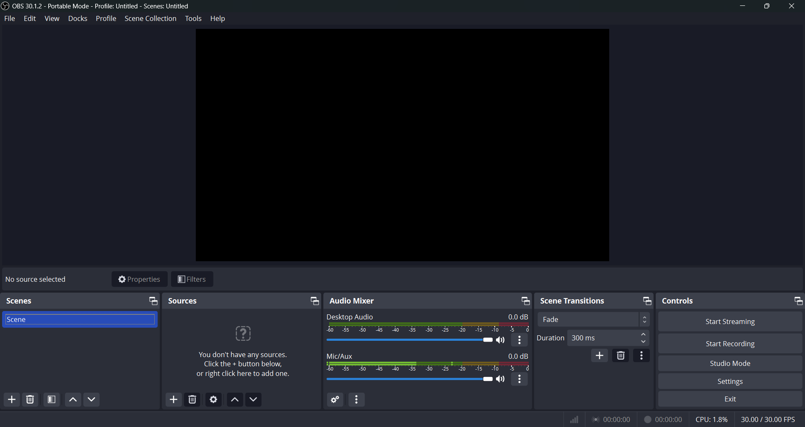

# 播放控制页（主窗口）重做调研

> 调研日期：2026-10-30。目标：为 `LivePlatform` 主控制页（开播/预览/源选择）的彻底重做收集成熟产品的方案与截图，供下次开发评审。
> 截图仅 OBS Studio 成功获取并随文档入库（Wikimedia Commons，CC 许可）；B 站直播姬 / Streamlabs / Prism 的官网与教程页均为 JS 渲染或防盗链，未能稳定下载截图，改为文字布局分析并附参考链接。

## 现状问题（对照当前主窗口截图）

- 控件平铺三行（Camera / Microphone / Server / Bitrate / FPS / Encoder / 预览 / 开播 / 停播 / 状态），低频设置与核心动作视觉权重相同，噪音大。
- 新增的采集源（摄像头 / 桌面 / 窗口 / 文件）塞在一个下拉里，窗口选择器藏在二级下拉，可达性差。
- 推流状态只有右下角一行小字；没有直播时长、实时码率、FPS。
- 预览画布被控制区挤压，不符合"预览是主角"的成熟布局惯例。
- 标题仍是 pilipili 旧品牌图（品牌统一待办的一部分）。

## 参考产品

### OBS Studio 30（截图：）

经典五 dock 结构，信息分区最明确：

| 区域 | 内容 | 对我们的启示 |
| --- | --- | --- |
| 预览画布 | 占窗口约 60%，上方只有菜单栏 | 预览应当是主角 |
| Scenes / Sources | 垂直列表 + 加号/删除/上下移工具条 | 源管理用"列表 + 明确的添加动作"，而非隐藏下拉 |
| Audio Mixer | 每路音量条 + 静音/设置 | 我们暂无音频表，可列为远期 |
| Scene Transitions | 转场选择 | 无需 |
| Controls | Start/Stop Streaming 大按钮 + Settings | 核心动作唯一且大；设置收进对话框 |
| 底部状态条 | 会话时长、录制时长、CPU、实时 FPS | 常驻状态信息，不做小字 |

### Streamlabs Desktop（未获取截图，文字分析）

三栏布局：左侧 Scenes/Sources 合并的垂直列表，中央大预览，右侧 Controls（Start Streaming）+ 活动/聊天；添加源走"＋ → 分类向导"引导流程。相比 OBS 更克制，默认隐藏高级面板。启示：**向导式添加源**可以大幅降低理解成本，我们的"摄像头/桌面/窗口/文件"四类源正好可以做成 4 个卡片按钮。

### B 站直播姬（未获取截图，参考：[官方教程](https://www.bilibili.com/opus/1080978435891789828)、[使用方法图文](https://m.jisuxz.com/article/39355.html)、[开播设置](https://live.vivo.com/qna/setting-bilibili/mobile)）

与我们定位最接近的产品（选源 → 一键开播）：

- **单屏极简**：左侧素材库（摄像头 / 游戏源 / 全屏 / 进程 / 多媒体 / 文本 / 图片），中央大预览画布，右侧弹幕互动列表，底部直播间信息 + **一键开播**大按钮。
- 推流参数（分辨率 / 码率 / 帧率 / 编码器）全部收进"直播设置"对话框，主界面不出现。
- 采集源以"素材卡片"形式添加，不是下拉框。

### Prism Live Studio / Restream Studio（未获取截图，参考：[PRISM 官方指南](https://guide.prismlive.com)、[Restream](https://restream.io/)）

- Prism：源卡片化 + 滤镜/特效导向，适合美颜/虚拟背景类功能扩展。
- Restream Studio：网页版"会议式"控制（先选摄像头/麦克风 → Go Live），把设备选择做成了**流程**而不是常驻控件。

## 共性模式提炼

1. **预览画布是主角**：占 ≥ 60% 面积，其余控件围绕它。
2. **核心动作唯一且大**：开播/停播是一个醒目按钮（且始终可见），不是和设置项并排的小按钮。
3. **低频参数收纳**：分辨率 / 码率 / 帧率 / 编码器 / 服务器全部进设置对话框，主界面不出现（直播姬、Streamlabs 均如此；OBS 放进 Settings）。
4. **状态常驻**：直播时长 + 实时码率 + FPS 放在状态条，推流中持续更新。
5. **源管理 = 列表/卡片 + 明确的添加动作**：不用下拉框藏四级选择。
6. **危险/次要动作弱化**：停播、设置在视觉上低于开播。

## 重做提案

### 提案 A：直播姬式单屏极简（推荐）

```
┌──────────────────────────────────────────────────────────┐
│ [logo]  PostLive                          ─  □  ✕        │ ← 标题栏（品牌统一时换图）
├──────────────────────────────────────────────────────────┤
│  添加源： [📷 摄像头] [🖥 整个屏幕] [🪟 窗口…] [📁 文件…] │ ← 素材卡片行（当前源高亮）
├──────────────────────────────────────────────────────────┤
│                                                          │
│                    预览画布（16:9，占 ~65%）              │
│            FFmpegWidget：无源时显示引导文案               │
│                                                          │
├──────────────────────────────────────────────────────────┤
│  [● 开播]  00:12:34  ↑3200kbps  30fps   麦克风 ▾  ⚙ 设置 │ ← 控制条
└──────────────────────────────────────────────────────────┘
```

- 素材卡片行取代现在的 sourceComboBox + camera/window/file 三组控件：点卡片即切源（摄像头保留摄像头/麦克风下拉弹层或进入卡片二级；窗口弹出窗口列表；文件弹文件选择）。推流中禁用。
- 控制条：开播大按钮（推流中变为红色"停播"）、时长 / 码率 / FPS 状态（FFmpeg 进程读 stderr 或后续由进程内数据补充）、麦克风快捷下拉、设置按钮。
- 分辨率 / 码率 / 帧率 / 编码器 / 服务器全部移入现有 `LiveLoginSettingDialog`（新增"推流设置"页）。
- 工作量：主要是 LivePlatform.ui 重排 + 现有控件搬家；`buildStreamArgs` / FFmpegWidget / WindowList 全部复用，无媒体逻辑改动。

### 提案 B：OBS 式面板（为多源预留）

```
┌────────────┬──────────────────────────────┬────────────┐
│ 源列表      │                              │  控制面板   │
│ ┌────────┐ │        预览画布               │ ┌────────┐ │
│ │摄像头   │ │                              │ │ ● 开播  │ │
│ │屏幕     │ │                              │ │ 停播    │ │
│ │窗口:xx  │ │                              │ │ 设置    │ │
│ └────────┘ │                              │ └────────┘ │
│ [+ 添加源] │  [画布比例▾] [截图] [全屏]     │  直播信息   │
├────────────┴──────────────────────────────┴────────────┤
│ 00:12:34  ↑3200kbps  30fps  CPU 2%       已连接 rtmp://… │
└──────────────────────────────────────────────────────────┘
```

- 左侧源列表 + 添加按钮（为将来的多源合成 / 场景预留结构）；中央画布带比例切换工具条；右侧控制 + 信息；底部状态条。
- 工作量更大：源列表的状态管理、（若做多源）进程内合成渲染。**只有确定要做"多源/场景"时才值得选它**。

## 建议与待定问题（下次开工前确认）

1. **单源 vs 多源/场景**：当前是单源产品，提案 A 足够；若计划做多源合成（画中画等），直接上提案 B 的骨架。→ 需要拍板。
2. **服务器地址放哪**：提案 A 收进设置对话框（直播姬模式）；若测试频繁，可在设置里加"最近使用的地址"下拉。
3. **音频**：是否需要音量表 / 混音条（OBS 式）？当前推流音频由 ffmpeg.exe 处理，进程内拿不到电平，需要额外管线 → 建议列远期。
4. **预览画布**：固定 16:9 还是自适应内容比例；无源时的引导文案与交互（点击素材卡片添加）。
5. **品牌统一**：标题图换成 PostLive 自有 logo（顺手解决 pilipili 遗留）。
6. **实时码率/FPS 来源**：短期用 ffmpeg.exe `-progress pipe:` 输出解析，长期随进程内推流管线解决。

## 截图来源与许可

- `images/broadcast-ui/obs-studio-30.png`：OBS Studio 30.1.2 默认界面，来自 [Wikimedia Commons](https://commons.wikimedia.org/wiki/File:OBS_Portable_30.1.2.png)（社区上传，遵循 Commons 许可）。
- B 站直播姬 / Streamlabs / Prism / Restream：未获取截图，布局描述基于公开教程与官方页面（链接见各节）。
